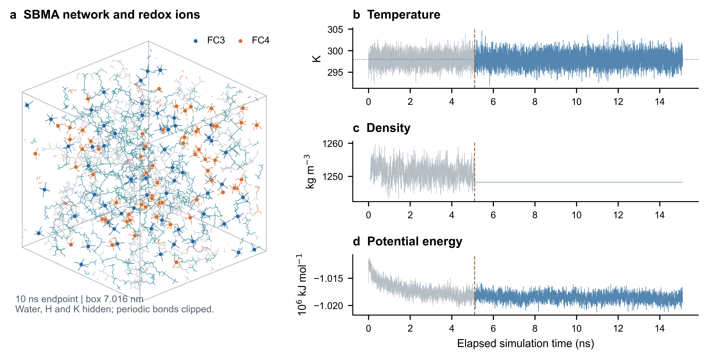
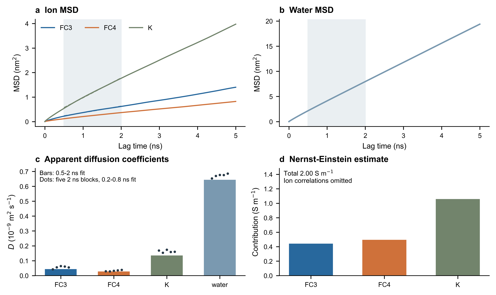
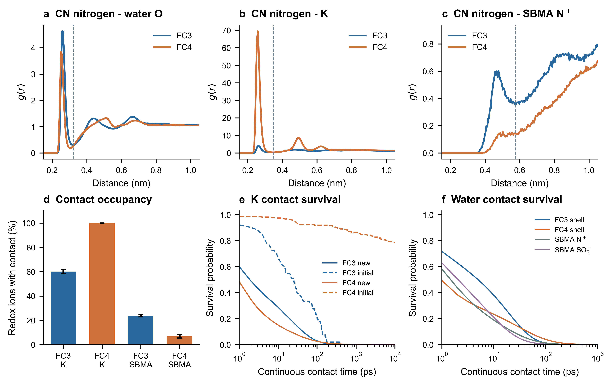

# 热电水凝胶 MD：计算记录与结果核验

供合作者核验方法、参数与结果。当前首页展示 **SBMA 1.0 g 的一条 10 ns 生产轨迹**；数值运行正常结束，不代表物理验证或专家放行。

## 先看结果

**[打开两页结果 PDF](reviews/2026-10-28_SBMA_1.0g/SBMA1.0g_结果核验.pdf)** · [下载 PDF](reviews/2026-10-28_SBMA_1.0g/SBMA1.0g_结果核验.pdf?raw=true) · [核心数值 CSV](reviews/2026-10-28_SBMA_1.0g/原始材料/结果摘要.csv)

本次重点请核验：

1. **平衡与扩散采样**：100 ps NVT + 5 ns NPT 后生产 10 ns。两种氧化态的 MSD 对数斜率约为 0.75、0.82，尚未清楚达到正常扩散的 1；扩散系数及 NE 电导率按暂定估计报告。
2. **离子配对**：按 CN 末端 N–K ≤ 0.3475 nm 的共同标准，FC3、FC4 至少接触一个 K 的占有率为 60.1%、100%。平均接触 K 数分别约为 0.94、4.47。
3. **长时接触**：初始 FC4–K 接触中，78.8% 在整个 10 ns 内未断开。这是初始接触的剩余存留下限，不是完整平均寿命。

FC3 = Fe(CN)₆³⁻；FC4 = Fe(CN)₆⁴⁻。以上结果只对应本条轨迹，不能据此判断相对 PAM 或 CBMA 的改善，也不直接等于器件 I–V 或响应时间。

### 运行状态与末态



### 扩散与近似电导率



柱为 0.5–2 ns 滞后窗的表观拟合；散点是五个 2 ns 时间块的短窗拟合，不能当作独立网络重复。NE 电导率约 2.00 S/m，忽略离子间运动关联，且受扩散采样限制。

### 局部结构、接触与存留



FC4–季铵位点没有可清楚分辨的首峰，沿用 FC3 的壳层边界只用于统一几何邻近比较，不认定为特异配对。存留按 1 ps 间隔分析，不能分辨更快的断裂；新生接触寿命与初始接触剩余存留分开报告。

## 查设置、数据和脚本

| 内容 | 入口 |
|---|---|
| 实际拓扑、MDP、TPR、始末构型、能量与日志 | [SBMA 1.0 g 输入及证据](reviews/2026-10-28_SBMA_1.0g/原始材料/SBMA_1.0g) |
| 被拓扑引用的完整力场文件 | [library](reviews/2026-10-28_SBMA_1.0g/原始材料/library) |
| RDF、MSD、接触、存留及集体电荷位移数据 | [数据](reviews/2026-10-28_SBMA_1.0g/原始材料/数据) |
| 可编辑 PDF/SVG 和高清 PNG | [图表](reviews/2026-10-28_SBMA_1.0g/原始材料/图表) |
| 分析、绘图、报告及模拟脚本 | [脚本与方法](reviews/2026-10-28_SBMA_1.0g/原始材料/脚本与方法) |
| RESP 来源及参数审计 | [原始材料](reviews/2026-10-28_SBMA_1.0g/原始材料) |
| 分析范围与限制 | [读取说明](reviews/2026-10-28_SBMA_1.0g/原始材料/读取说明.txt) |

设置：OPLS + 核心约束 RESP + SPC/E，298 K、0.5 fs；固定体积 NVT 生产。当前只有单网络、单轨迹，时间块波动不是独立重复置信区间。本批未计算氢键分布、热电压或器件响应时间。

## 复画图表

安装 Python 依赖后运行：

```bash
python -m pip install -r requirements.txt
python tools/plot_sbma.py
```

该入口使用仓库内数据和输入构型，不需要大轨迹。原执行脚本作为审计记录保留；如重新分析完整轨迹，需要提供 XTC 并按自己的目录设置输入路径。逐事件大表以 `.csv.gz` 无损压缩。

完整 XTC 留存在原计算工作站，未上传；原始存帧间隔为 0.1 ps，本批 RDF 每 10 ps、输运与接触每 1 ps 均匀取帧。需要完整轨迹时联系仓库维护者。

发布副本将文本中的本机目录作占位替换，不改变拓扑物理参数、MDP、TPR、GRO 和 EDR 数值。`published_files.sha256` 对应本次发布副本；审查问题可直接在 [Issues](https://github.com/swucb/polymer-thermocell-md/issues) 中提出。

`输入校验清单.json`记录原文件哈希；路径脱敏后的日志可能不同。核对公开副本请使用根目录的`published_files.sha256`。
